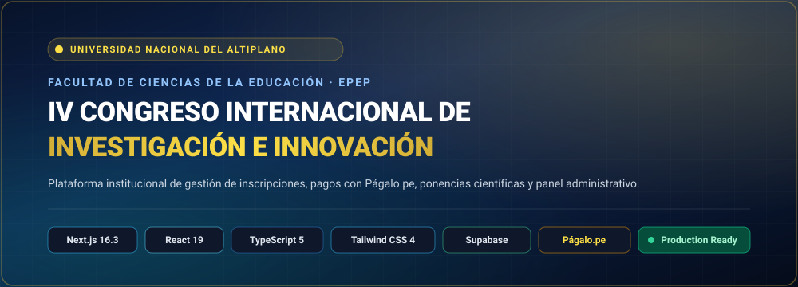
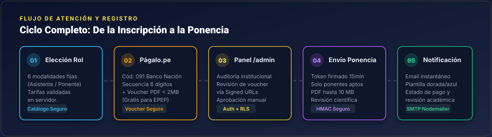
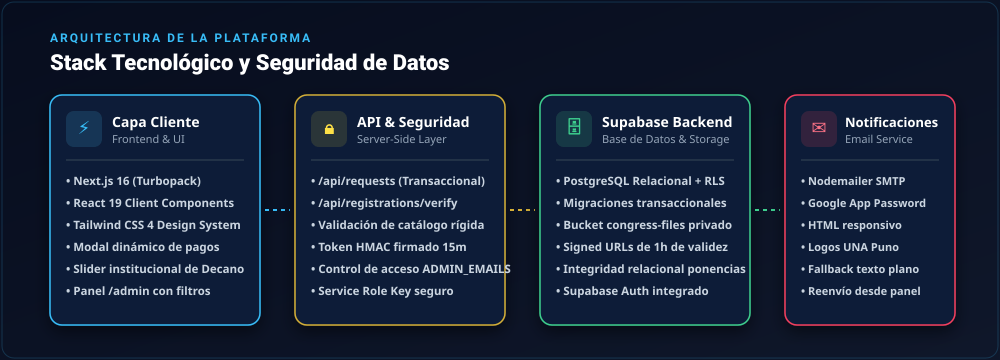

<div align="center">



<br/>
<br/>

[](https://nextjs.org/)
[](https://react.dev/)
[](https://www.typescriptlang.org/)
[](https://tailwindcss.com/)
[](https://supabase.com/)
[](https://www.coninci2026.com/)

<p align="center">
  <b>Plataforma web oficial para la gestión integral de inscripciones académicas, validación de comprobantes de pago de Págalo.pe, recepción de ponencias científicas y panel administrativo de control.</b>
</p>

[🌐 Sitio Web Oficial](https://www.coninci2026.com/) • [📋 Ver Tarifas](#-tarifas-y-modalidades) • [🏛️ Arquitectura](#-arquitectura-del-sistema) • [🚀 Puesta en Marcha](#-instalación-y-configuración) • [🔐 Panel Admin](#-panel-de-administración-admin)

</div>

---

## 📌 Acerca del Proyecto

El **IV Congreso Internacional de Investigación Científica e Innovación** es el evento insignia organizado por la **Facultad de Ciencias de la Educación (FCEDUC)** y la **Escuela Profesional de Educación Primaria (EPEP)** de la **Universidad Nacional del Altiplano de Puno (UNA Puno)**.

Esta plataforma fue diseñada para resolver de manera robusta y automatizada el flujo académico e institucional del congreso:
- **Inscripciones segmentadas** para estudiantes, docentes y profesionales (locales y externos).
- **Procesamiento de pagos del Banco de la Nación / Págalo.pe** (código de tasa educativa 091).
- **Recepción segura de artículos de investigación** con verificación criptográfica (HMAC).
- **Panel de auditoría y gestión administrativa** con autenticación Supabase y enlaces privados firmados.
- **Sistema de notificaciones automáticas por correo electrónico** con plantillas institucionales HTML/CSS y soporte para reintentos.

---

## 🔄 Flujo del Sistema

<div align="center">
  
</div>

El ciclo operativo garantiza trazabilidad y rigor institucional en 5 fases:

1. **Elección de Categoría y Modalidad**: El participante escoge su rol (Asistente o Ponente) según su perfil (Estudiante EPEP, Docente EPEP, Estudiante Externo o Público General).
2. **Registro y Voucher Págalo.pe**: Para modalidades con costo, se ingresa la secuencia de 6 dígitos del comprobante del Banco de la Nación y se sube el comprobante en formato PDF (límite 2 MB). Las modalidades internas de la EPEP quedan exoneradas según normativa.
3. **Auditoría Administrativa**: El equipo organizador revisa la autenticidad de los comprobantes desde el panel privado `/admin` mediante URLs firmadas con caducidad temporal (1 hora).
4. **Envío de Ponencias Científicas**: Una vez verificado y aprobado el pago (o condición interna), el ponente accede a la plataforma de recepción mediante una firma criptográfica válida por 15 minutos, adjuntando su investigación en PDF (hasta 10 MB).
5. **Notificación Transaccional**: El usuario recibe confirmaciones detalladas por correo en cada etapa (recepción, aprobación de pago, estado de revisión académica y observaciones).

---

## 🏛️ Arquitectura del Sistema

<div align="center">
  
</div>

### Componentes Clave:

| Módulo | Tecnologías | Responsabilidad |
|---|---|---|
| **Frontend** | Next.js 16.3 (Turbopack), React 19, Tailwind CSS 4 | Experiencia de usuario ultra rápida, slider de autoridades (Decano de FCEDUC), modales accesibles y diseño responsivo. |
| **API Backend** | Next.js Route Handlers (`/api/requests`, `/api/registrations/verify`) | Validación estricta del catálogo de precios en servidor, firma y validación de tokens de ponencia, upload streaming a Supabase Storage. |
| **Persistencia** | PostgreSQL en Supabase | Base de datos relacional con RLS (Row Level Security), esquema con integridad referencial y migraciones transaccionales. |
| **Almacenamiento** | Supabase Storage (`congress-files`) | Bucket privado para vouchers y ponencias. Acceso exclusivo mediante enlaces firmados (`createSignedUrl`) con vencimiento. |
| **Correos** | Nodemailer + Google Workspace / Gmail SMTP | Plantilla HTML institucional (Navy `#0F2756` y Gold `#D4AF37`), con imágenes adjuntas, texto plano y detección de errores SMTP. |

---

## 💳 Tarifas y Modalidades

La API del servidor **nunca confía en montos enviados desde el navegador**; la tarifa se calcula exclusivamente a partir del catálogo interno autorizado:

| Categoría | Modalidad | Tarifa Base | Cargo Institucional | Total a Pagar | Comprobante |
|---|---|:---:|:---:|:---:|:---:|
| **Estudiante EPEP** | Asistente | S/ 20.00 | S/ 1.00 | **S/ 21.00** | Obligatorio (Págalo.pe) |
| **Estudiante Externo** | Asistente / Ponente | S/ 30.00 | S/ 1.00 | **S/ 31.00** | Obligatorio (Págalo.pe) |
| **Asistente Externo** | Asistente General | S/ 70.00 | S/ 1.00 | **S/ 71.00** | Obligatorio (Págalo.pe) |
| **Ponente Externo** | Ponente Magistral / Mesa | S/ 100.00 | S/ 1.00 | **S/ 101.00** | Obligatorio (Págalo.pe) |
| **Docente EPEP** | Ponente | Gratis | S/ 0.00 | **Gratis** | Exonerado |
| **Estudiante EPEP** | Ponente | Gratis | S/ 0.00 | **Gratis** | Exonerado |

> [!NOTE]
> El cargo institucional de **S/ 1.00** corresponde al concepto estipulado por la organización del evento bajo el **Código 091** (*Tasas educativas UNA Puno - OTROS SERV. EDU. EDU. PRIMARIA* en Págalo.pe o agencias del Banco de la Nación).

---

## ⚙️ Preparación de Base de Datos (Supabase)

Antes de habilitar el formulario de registros, se debe aplicar la migración en el **SQL Editor** del proyecto Supabase:

```sql
-- Ejecutar en Supabase SQL Editor:
supabase/migrations/202610140001_registration_payments_and_papers.sql
```

### Características de la Migración:
- **Transaccional (`BEGIN ... COMMIT`)**: Si una sola instrucción falla, la base de datos se revierte intacta.
- **Preservación histórica**: Conserva inscripciones anteriores y clasifica pagos legítimos existentes.
- **Bucket Privado**: Configura automáticamente el bucket `congress-files` con políticas RLS para impedir acceso público no autorizado.
- **Integridad Referencial**: Impide que se registren ponencias sin una inscripción apta y confirmada.

---

## 🚀 Instalación y Configuración

### 1. Clonar el repositorio e instalar dependencias

```bash
git clone https://github.com/jcesargithl/webcongreso.git
cd congreso-app
npm install
```

### 2. Configurar variables de entorno

Crea el archivo `.env.local` en la raíz del proyecto:

```env
# Conexión Supabase
NEXT_PUBLIC_SUPABASE_URL=https://tu-proyecto.supabase.co
NEXT_PUBLIC_SUPABASE_ANON_KEY=tu_anon_key
SUPABASE_SERVICE_ROLE_KEY=tu_service_role_key_privada

# Seguridad del Panel Administrativo
ADMIN_EMAILS=administrador1@unap.edu.pe,administrador2@unap.edu.pe

# Servicio de Correo Transaccional (Nodemailer / Gmail)
GMAIL_USER=tu_cuenta@gmail.com
GMAIL_PASS=tu_contraseña_de_aplicacion_google

# Firma Criptográfica para Ponencias (Opcional - genera fallback seguro)
PAPER_VERIFICATION_SECRET=cadena_secreta_larga_y_aleatoria_para_firmar_tokens
```

> [!CAUTION]
> **Nunca** expongas ni subas al control de versiones `SUPABASE_SERVICE_ROLE_KEY`, `GMAIL_PASS` o el archivo `.env.local`.

### 3. Ejecutar en entorno local

```bash
# Servidor de desarrollo con Turbopack
npm run dev

# Ejecutar suite de pruebas
npm run test

# Verificación de TypeScript y Linter
npm run lint

# Compilación para producción
npm run build
npm run start
```

---

## 🔐 Panel de Administración (`/admin`)

La ruta `/admin` está protegida mediante **Supabase Auth** y validación de lista blanca con `ADMIN_EMAILS`:

- **Gestión de Comprobantes**: Visualización de vouchers mediante enlaces firmados temporales de 1 hora.
- **Acciones Rápidas**: Aprobar o rechazar pagos con ingreso de observaciones de auditoría.
- **Estado de Ponencias**: Revisión independiente del estado académico de las investigaciones adjuntas.
- **Reenvío de Notificaciones**: Botón de reenvío para disparar correos en caso de problemas temporales de conectividad SMTP.
- **Filtros Avanzados**: Búsqueda por documento, estado de pago, modalidad y categoría.

---

## 📂 Estructura del Código

```text
congreso-app/
├── public/
│   ├── readme/                  # Diagramas e imágenes SVG de documentación
│   │   ├── banner.svg
│   │   ├── workflow.svg
│   │   └── architecture.svg
│   └── autoridades/             # Fotografías oficiales de autoridades y ponentes
├── src/
│   ├── app/
│   │   ├── admin/page.tsx       # Panel administrativo de revisión
│   │   ├── api/
│   │   │   ├── registrations/
│   │   │   │   └── verify/      # Endpoint de verificación y emisión de tokens
│   │   │   └── requests/        # Endpoint transaccional de pagos y ponencias
│   │   ├── globals.css          # Sistema de diseño con CSS tokens
│   │   └── page.tsx             # Landing page principal del congreso
│   ├── components/
│   │   ├── authority-slider.tsx # Carrusel de mensajes de autoridades
│   │   └── request-modal.tsx    # Modal de inscripción, pagos y ponencias
│   └── lib/
│       ├── authorities.ts       # Mensajes institucionales (Decano, Dirección)
│       ├── congress.ts          # Tarifas, roles y reglas del evento
│       ├── email.ts             # Cliente SMTP y lógica de envío de correos
│       ├── email-template.ts    # Plantilla HTML/CSS institucional
│       ├── registration-rules.ts# Validaciones de negocio y seguridad
│       └── supabase-server.ts   # Cliente seguro con Service Role
├── supabase/
│   └── migrations/              # Scripts SQL transaccionales
└── tests/
    └── registration-flow.test.mjs # Pruebas unitarias de flujo y tarifas
```

---

## 🏛️ Créditos Institucionales

- **Organiza**: Escuela Profesional de Educación Primaria (EPEP).
- **Facultad**: Facultad de Ciencias de la Educación (FCEDUC).
- **Institución**: Universidad Nacional del Altiplano de Puno (UNA Puno).
- **Contacto**: [subdireccion.investigacion.epep@unap.edu.pe](mailto:subdireccion.investigacion.epep@unap.edu.pe)

---

<div align="center">
  <p>© 2026 IV Congreso Internacional de Investigación Científica e Innovación. Todos los derechos reservados.</p>
</div>
